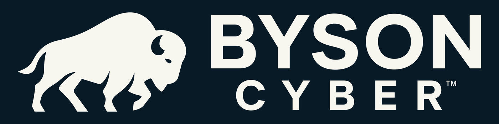

# Hey, I'm Blynn! 👋 🦬

**Founder of [Byson Cyber](https://bysoncyber.com) | Cybersecurity Consultant | Coffee Enthusiast ☕**

Welcome to my little corner of GitHub!

I run **Byson Cyber**, a cybersecurity consultancy focused on helping organizations reduce real risk through practical, understandable security improvements.

I believe cybersecurity shouldn't be unnecessarily complicated, intimidating, or inaccessible. Good security starts with understanding people, identifying what matters, and making thoughtful improvements along the way.

And sometimes, that means fixing a printer. 😂

## 🛡️ What I Work On

- **Microsoft 365 & Google Workspace Security** — Hardening, identity protection, and configuration reviews.
- **Identity & Active Directory Security** — Authentication, access management, and security improvements.
- **Email Security** — SPF, DKIM, DMARC, and phishing defenses.
- **Security Assessments** — Identifying risks and providing actionable recommendations.
- **Security Automation** — PowerShell, scripting, and tools that make life a little easier.
- **Education & Community** — Sharing knowledge and helping others grow in cybersecurity.

## 🧰 Featured Community Project

### [Byson Endpoint Maintenance — Community Beta](https://github.com/BysonCyber/community-endpoint-maintenance)

A PowerShell toolkit I built to make routine Windows endpoint maintenance a little less painful. It brings together common update and maintenance tasks, including Windows, Microsoft Defender, application updates, and supported OEM driver checks.

**[View the project](https://github.com/BysonCyber/community-endpoint-maintenance)** · **[Browse releases](https://github.com/BysonCyber/community-endpoint-maintenance/releases)**

> This is a community beta. Please review the documentation and test in an appropriate environment before deploying it broadly.

## 🤝 Why I Share

This GitHub is a place for practical scripts, security resources, experiments, and lessons learned along the way. I'll continue adding to it as useful things are ready to share.

Not everything needs to be a paid engagement. Sometimes a free tool, a helpful explanation, or an extra set of eyes makes all the difference.

## ☕ A Little About Me

I've spent my career working across cybersecurity and IT, from infrastructure and firewalls to security operations and consulting.

Outside of that, I'm usually roasting coffee, experimenting with espresso, mentoring others, or looking for opportunities to give back to the community.

Technology is important, but the people behind it matter more.

## 🌐 Let's Connect

- 🌎 **Website:** [BysonCyber.com](https://bysoncyber.com)
- 💼 **LinkedIn:** [Blynn Atchley](https://www.linkedin.com/in/blynn-atchley/)
- 🦬 **Company:** [Byson Cyber on LinkedIn](https://www.linkedin.com/company/bysoncyber/)
- ☕ **My Coffee Obsession:** [Coffee & Computers](https://coffeecomputers.net) — Where technology meets a really good cup of coffee!
- 📧 **Email:** [github@bysoncyber.com](mailto:github@bysoncyber.com)

---

### 🦬 Into The Storm.

*Practical cybersecurity. Real conversations. Helping people along the way.*

**Thanks for stopping by!**
